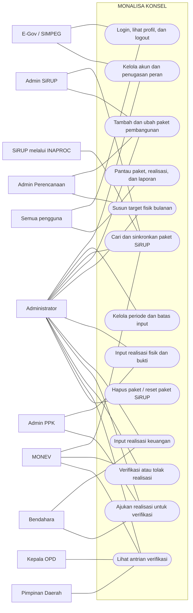
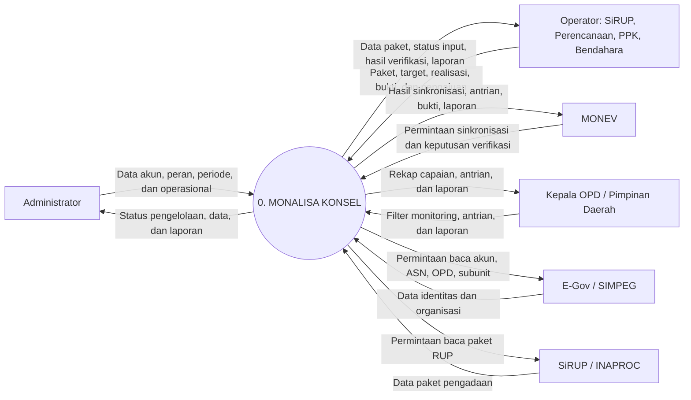
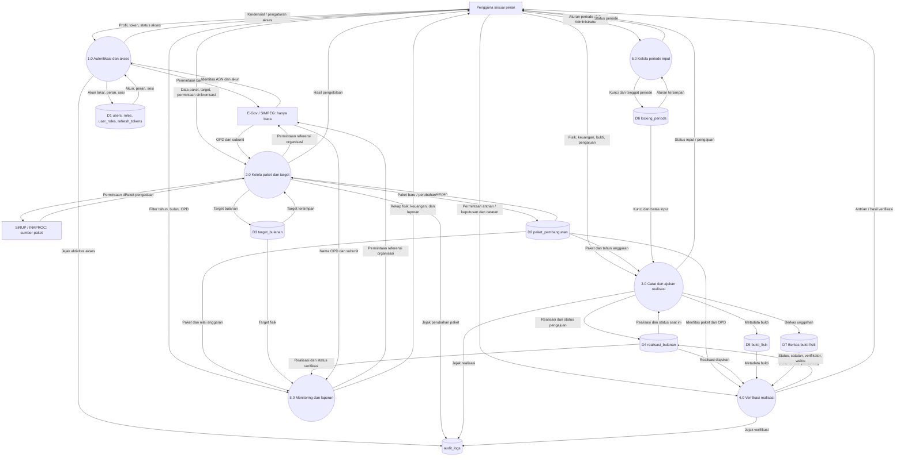
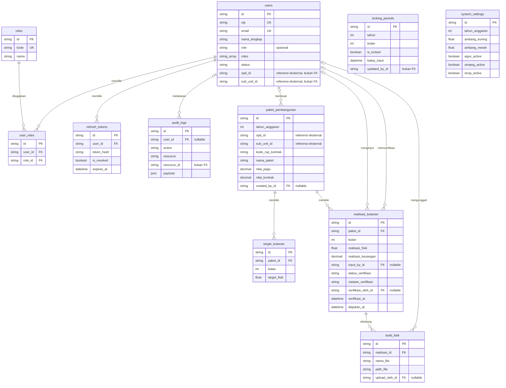

# Diagram Sistem MONALISA KONSEL

Disusun berdasarkan kode proyek SIMANTAP/MONALISA pada 14 Oktober 2026. Diagram menggambarkan implementasi lokal, bukan hasil pemeriksaan database produksi. Diagram alir data (DFD) menjelaskan perpindahan data, sedangkan ERD menjelaskan relasi tabel; keduanya disediakan agar dokumentasi lengkap.

## 1. Diagram use case

Diagram berikut menggunakan bentuk use case melalui Mermaid: kotak di luar batas sistem adalah aktor, bentuk oval adalah fungsi sistem, dan garis adalah asosiasi. “Semua pengguna” mewakili kedelapan peran untuk fungsi bersama, bukan peran tambahan. Autentikasi menjadi prasyarat fungsi yang dilindungi.

### Penjelasan hak akses

| Aktor | Kewenangan khusus |
| --- | --- |
| Administrator | Kelola akun/peran, periode, paket, target, fisik, keuangan, bukti, pengajuan, verifikasi, penghapusan dan reset paket. |
| Admin SiRUP | Tambah/ubah paket dan sinkronkan paket SiRUP. |
| Admin Perencanaan | Ubah paket yang sudah ada dan susun target fisik bulanan; tidak memiliki endpoint tambah paket. |
| Admin PPK | Input fisik, unggah/hapus bukti fisik, dan ajukan realisasi. |
| Bendahara | Input keuangan dan ajukan realisasi. |
| MONEV | Sinkronkan SiRUP, lihat antrian, verifikasi atau tolak realisasi. |
| Kepala OPD | Pantau data sesuai cakupan akses dan lihat antrian verifikasi. |
| Pimpinan Daerah | Pantau lintas OPD dan lihat antrian verifikasi. |

Semua peran dapat membaca paket, realisasi, laporan, periode, serta pencarian SiRUP sesuai pembatasan endpoint dan cakupan akses. Administrator, MONEV, dan Pimpinan Daerah memiliki cakupan lintas OPD pada layanan pembangunan; peran lain mengikuti OPD/subunit pengguna. Satu pengguna dapat memiliki beberapa peran. Input fisik dan keuangan dibatasi per kolom sesuai peran.

**Catatan implementasi:** persetujuan/penolakan realisasi dilakukan oleh MONEV atau Administrator. Kepala OPD dan Pimpinan Daerah hanya dapat membaca antrian melalui endpoint yang tersedia. Ini mengikuti controller saat ini, meskipun README lama menyebut approval oleh Kepala OPD.

## 2. Diagram alir data (DFD)

### 2.1 Diagram konteks

Satu proses mewakili seluruh MONALISA. Panah menuju sistem eksternal merupakan permintaan baca, bukan perubahan data eksternal.

### 2.2 DFD level 1

Data store D1–D6 merupakan pengelompokan tabel PostgreSQL. D7 menyimpan berkas bukti; metadata dan lokasi berkas berada pada D5. Cache teknis tidak ditampilkan agar fokus pada aliran data bisnis.

Otorisasi melekat pada setiap proses sesuai use case. Proses 4.0 menerima keputusan hanya dari Administrator/MONEV; pembacaan antrian juga tersedia bagi Kepala OPD/Pimpinan Daerah. `system_settings` tercantum dalam skema tetapi tidak diasumsikan sebagai fitur pengaturan aktif pada DFD ini.

## 3. Diagram relasi tabel (ERD)

Nama entitas mengikuti nama tabel fisik dari `@@map` Prisma. Kolom yang ditampilkan adalah kolom utama, bukan seluruh kolom. PK = primary key, FK = foreign key, UK = unique key. Notasi `||` berarti tepat satu, `o|` berarti nol atau satu, dan `o{` berarti nol atau banyak.

### Tabel relasi dan aturan penghapusan

| Tabel induk | Tabel anak | Foreign key pada anak | Kardinalitas induk → anak | Saat induk dihapus |
| --- | --- | --- | --- | --- |
| users | user_roles | user_id | 1 → 0..N | Cascade |
| roles | user_roles | role_id | 1 → 0..N | Cascade |
| users | refresh_tokens | user_id | 1 → 0..N | Cascade |
| users | audit_logs | user_id, nullable | 1 → 0..N | Set Null |
| users | paket_pembangunan | created_by_id, nullable | 1 → 0..N | Set Null |
| users | realisasi_bulanan | input_by_id, nullable | 1 → 0..N | Set Null |
| users | realisasi_bulanan | verifikasi_oleh_id, nullable | 1 → 0..N | Set Null |
| users | bukti_fisik | upload_oleh_id, nullable | 1 → 0..N | Set Null |
| paket_pembangunan | target_bulanan | paket_id | 1 → 0..N | Cascade |
| paket_pembangunan | realisasi_bulanan | paket_id | 1 → 0..N | Cascade |
| realisasi_bulanan | bukti_fisik | realisasi_id | 1 → 0..N | Cascade |

`Cascade` pada `bukti_fisik` berlaku untuk baris database; penghapusan berkas fisik merupakan tanggung jawab aplikasi.

### Batasan unik dan relasi logis

- `users.nip`, `users.email`, dan `roles.kode` masing-masing unik.
- `user_roles(user_id, role_id)` unik: pengguna tidak mendapat baris penugasan peran yang sama dua kali. Tabel ini menghubungkan users dan roles secara many-to-many.
- `target_bulanan(paket_id, bulan)` unik: satu target per paket per bulan.
- `realisasi_bulanan(paket_id, bulan)` unik: satu realisasi per paket per bulan. Fisik dan keuangan tersimpan pada baris yang sama.
- `locking_periods(tahun, bulan)` unik. Pencocokan dengan paket/realisasi dilakukan aplikasi berdasarkan tahun anggaran dan bulan, tanpa foreign key.
- `users.opd_id`, `users.sub_unit_id`, `paket_pembangunan.opd_id`, dan `paket_pembangunan.sub_unit_id` merupakan referensi organisasi eksternal, tanpa foreign key PostgreSQL ke E-Gov/SIMPEG. Tidak ada tabel OPD lokal pada skema ini.
- `locking_periods.updated_by_id` dan `audit_logs.resource_id` tidak dideklarasikan sebagai foreign key dalam Prisma.
- `system_settings` berdiri sendiri, tanpa relasi foreign key.
- `users.role` dan `users.roles` juga ada bersama tabel `user_roles`; keduanya ditampilkan sebagai atribut, bukan relasi tambahan yang tidak ada dalam skema.
- Status verifikasi yang tersedia: `DRAFT`, `DIAJUKAN`, `TERVERIFIKASI`, `DITOLAK`. Verifikasi/penolakan mensyaratkan status `DIAJUKAN`; hasil terverifikasi tidak dapat diedit oleh operator biasa.

## 4. Sumber implementasi

- [Skema Prisma](../../backend/prisma/schema.prisma): 11 tabel dan 11 foreign key.
- [Controller pembangunan](../../backend/src/modules/pembangunan/pembangunan.controller.ts): akses paket, target, periode, realisasi, bukti, laporan, dan verifikasi.
- [Service pembangunan](../../backend/src/modules/pembangunan/pembangunan.service.ts): cakupan OPD, perlindungan kolom, periode, dan status verifikasi.
- [Controller SiRUP](../../backend/src/modules/sirup/sirup.controller.ts) dan [service SiRUP](../../backend/src/modules/sirup/sirup.service.ts): akses dan integrasi INAPROC.
- [Controller pengguna](../../backend/src/modules/users/users.controller.ts) dan [controller autentikasi](../../backend/src/modules/auth/auth.controller.ts): akun, peran, dan sesi.

Diagram Mermaid dapat ditampilkan melalui preview Markdown yang mendukung Mermaid. Sumber UML use case juga tersedia dalam `usecase.puml` untuk dirender menggunakan PlantUML.
